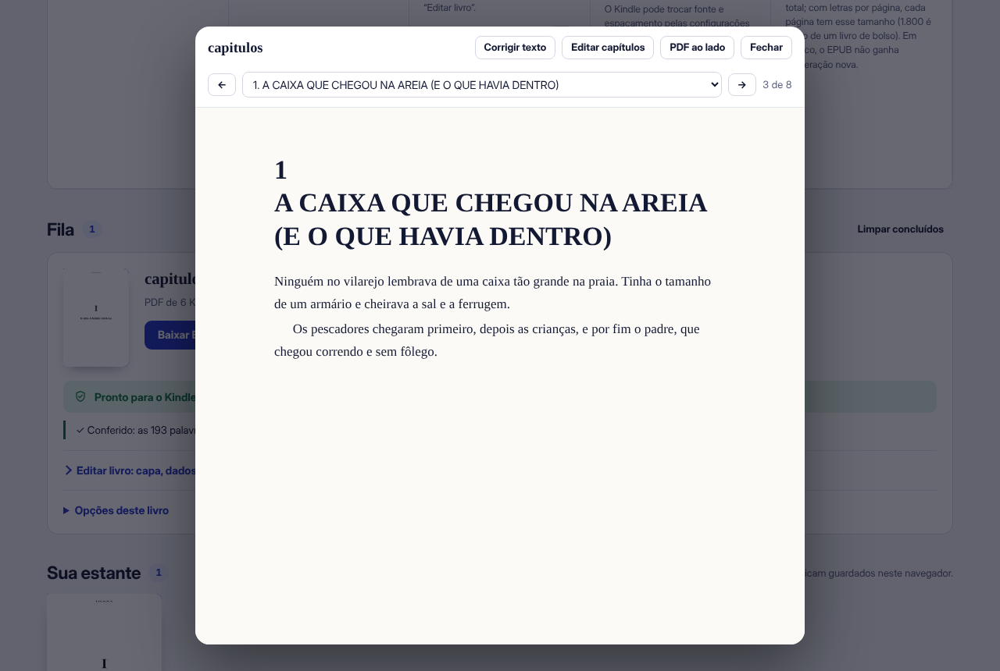
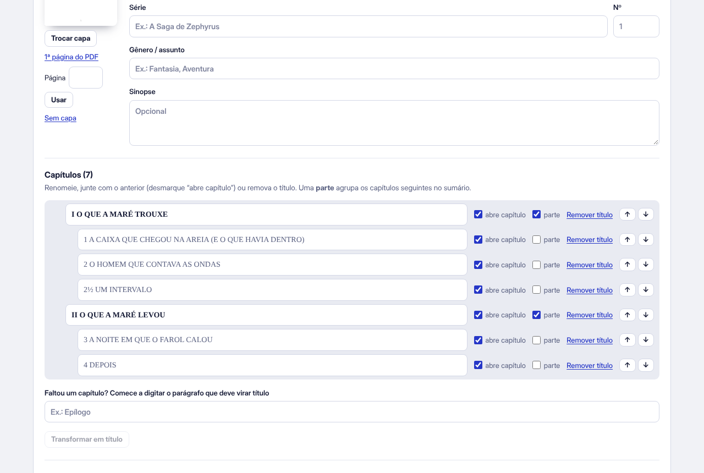

# Lombada: PDF para EPUB

Converte PDF, DOCX, MOBI e outros formatos em EPUB para ler no Kindle, com capítulos, sumário, notas clicáveis, números de página e o texto conferido palavra por palavra. Roda inteiro no navegador: **o arquivo não sai do seu computador**.

**Use em: [mizaeldouglas.github.io/conversor-epub](https://mizaeldouglas.github.io/conversor-epub/)**


## O que ele faz

- **Texto igual ao PDF.** O espaço entre palavras só entra onde o PDF tem um espaço de verdade, e palavras desenhadas sem espaço são separadas pelas palavras conhecidas. Itálico, negrito, capitular e ligaduras (“fi”, “fl”) voltam ao normal.
- **Conferência palavra por palavra.** O EPUB pronto é lido de volta e comparado com o PDF. As diferenças aparecem com a página, e dá para abrir o PDF ao lado e corrigir.
- **Capítulos e partes.** Títulos em fonte maior, “Capítulo 12”, número grande em cima do título e títulos em várias linhas viram capítulos. Partes (“Parte II”, ou numeração romana acima de capítulos numerados) agrupam os capítulos no sumário.
- **Editar antes de baixar.** Renomeie, junte, separe e marque partes; transforme qualquer parágrafo em capítulo; troque a capa (imagem sua ou qualquer página do PDF); mude título, autor, série e sinopse; localize e substitua no livro todo.
- **Selo de qualidade.** Cada EPUB tem a estrutura conferida (o essencial do EPUBCheck) antes do download.
- **Vários formatos.** Além de PDF e EPUB, abre DOCX, TXT, HTML, Markdown, FB2, MOBI/AZW3 sem proteção e CBZ.
- **PDFs difíceis.** Usa o sumário interno do PDF, lê duas colunas na ordem certa e mantém tabelas, listas, links e versos.
- **Correção na prévia.** Clique num parágrafo para reescrever; mude a ordem dos capítulos; desfaça a última alteração.
- **Mais:** KEPUB para Kobo, imagens menores ou em tons de cinza, descrição das imagens, capa e sinopse da internet, notas de rodapé clicáveis, quebras de cena, números de página no padrão EPUB 3, OCR para páginas escaneadas, quadrinhos e mangá em página fixa, juntar volumes, numerar páginas de um EPUB pronto, estante com os últimos livros e app instalável que funciona sem internet.

| Prévia com o sumário | Capítulos e partes |
| --- | --- |
|  |  |

## Privacidade

A leitura do PDF, a montagem do EPUB, a conferência e o OCR acontecem no navegador. Nenhum arquivo é enviado, e o site não usa cookies nem contadores de visita. Duas funções mandam algo para fora, e só quando você pede: “Buscar dados deste livro” envia o título e o autor à Open Library (e, se ela não achar, ao Google Books), e “Entrar com Google” guarda os EPUBs prontos numa pasta Lombada do seu próprio Google Drive. O Lombada não tem servidor e não recebe os livros. O navegador baixa só o próprio programa: pdf.js e JSZip do cdnjs, as fontes do Google Fonts e, com o OCR ligado, o Tesseract do jsDelivr. A estante, as opções e as correções lembradas ficam só no seu navegador e podem ser apagadas em “Como funciona > Privacidade”.

## Limitações conhecidas

- Livros com DRM não abrem, em nenhum formato. MOBI com compressão Huffman e CBR também não.
- MOBI e AZW3 foram testados com arquivos gerados para os testes; arquivos de loja podem ter variações.
- A interface em inglês e espanhol é uma camada de tradução sobre os textos em português (`src/data/idiomas.json`); um texto novo sem tradução aparece em português, e o teste `tests/idiomas.test.mjs` acusa.
- Páginas com texto em várias colunas (créditos, índices) podem sair na ordem das colunas lidas de cima para baixo.
- O OCR pode trocar letras; confira na prévia com o PDF ao lado.
- O Kindle mostra posições, não páginas. Use “Número da página no texto” se quiser ver o número lá.

## Login com Google

No site, o app só abre depois de entrar com o Google; antes disso aparece a página de apresentação. Esse bloqueio é feito no navegador (o site não tem servidor), então serve para organizar a estante de cada pessoa, não como proteção. O login só existe quando `googleClientId`, no `package.json`, tem o ID de um cliente OAuth do Google (termina em `.apps.googleusercontent.com`). O ID não é segredo: ele fica visível na página. O app pede só o escopo `drive.file`, que dá acesso apenas aos arquivos criados pelo próprio Lombada. Os testes usam um Google simulado (`tests/fake-google.mjs`).

## Desenvolvimento

O código fica em `src/` e o `index.html` publicado é montado a partir dele:

```
src/index.html        página (HTML) com os marcadores do build
src/style.css         estilos
src/js/NN-*.js        módulos, na ordem do número (leitura do PDF, DOCX, EPUB, fila, prévia…)
src/sw.js             service worker (app instalável e sem internet)
src/data/             lista de palavras do português
tools/build.mjs       monta index.html e sw.js na raiz
tests/                testes de ponta a ponta (Playwright) e arquivos de teste
```

```bash
npm install                                  # pdf.js e JSZip nas versões do site
npm install --no-save playwright && npx playwright install chromium
npm run build                                # gera index.html e sw.js
npm test                                     # converte os arquivos de tests/fixtures e confere tudo
```

Os testes abrem o app num Chromium, convertem os PDFs de `tests/fixtures` e conferem o sumário, o texto, os erros, a acessibilidade e o teclado. Com `EPUBCHECK_JAR` apontando para o EPUBCheck, cada EPUB gerado também é validado. Os arquivos de teste são gerados por `tools/gerar-fixtures.py`, com texto escrito só para isso.

A cada push, o GitHub Actions confere se o `index.html` está em dia com `src/`, roda os testes e o EPUBCheck e, se tudo passar, publica o site.

## Licença

Código sob a licença MIT (veja [LICENSE](LICENSE)). A lista de palavras do português vem de [hermitdave/FrequencyWords](https://github.com/hermitdave/FrequencyWords) (CC BY-SA 4.0). Bibliotecas: [pdf.js](https://mozilla.github.io/pdf.js/) (Apache 2.0), [JSZip](https://stuk.github.io/jszip/) (MIT) e [Tesseract.js](https://tesseract.projectnaptha.com/) (Apache 2.0).
